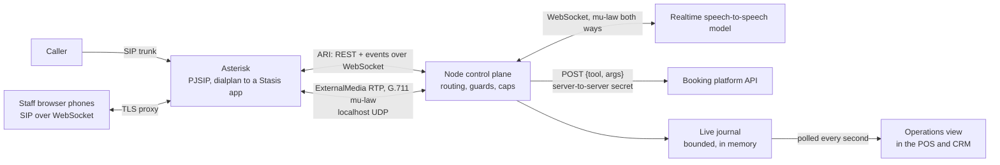

# Realtime voice booking agent: a design case study

A phone agent that answers a business's booking lines in English and Spanish and books, moves and cancels appointments directly in the live calendar. It ran in production on the booking lines of a multi-location beauty-industry brand, connected to the point-of-sale and booking platform built for that brand.

The source is private. This write-up covers the architecture and the decisions that made it safe to put on real customer calls.

## What it does

- **People first, agent second.** Staff browser phones ring first, with a visible countdown. The agent picks up only when nobody answers, or immediately when the caller chooses "book an appointment" in the phone menu.
- **Knows the caller before it speaks.** While the call connects it looks up the caller by caller ID: upcoming appointments, past visits, preferred language, and the services, prices and hours of every location.
- **Changes the real calendar.** It books, moves and cancels appointments, leaves messages on the client's profile, and transfers to a person.
- **Hands off in both directions.** Staff can send a ringing call to the agent, or take a call from it mid-conversation with one click.
- **Shows its work.** A live operations view shows every conversation, its transcript and each appointment change as it happens.
- **A second persona** on a sales line qualifies prospects and requests demos in the CRM, with one lead record per call.

## Architecture

- **Asterisk handles telephony; Node makes every decision.** The dialplan hands each call to a Stasis application. Node drives it through ARI (answer, bridge, record, transfer, hang up) and owns routing, guards and cost limits.
- **No transcoding.** The phone network's G.711 mu-law is exactly what the speech model takes in and sends back. Caller audio is batched into 100 ms chunks. Model audio is paced back out as 20 ms RTP frames with their own sequence numbers, timestamps and SSRC.
- **Barge-in that keeps the record straight.** When the caller talks over the agent, playback stops and the model's reply is cut at the point the caller actually heard. What the model remembers saying matches what was said.
- **Identity comes from the network, not the model.** The bridge injects the caller's number and the call id into every tool call. The model can't name another number, so it can't look up or change someone else's appointments.
- **One tool endpoint on the platform.** Every action is a single `POST {tool, args}` with a server-to-server secret and a timeout. Errors come back as plain sentences the agent can say to the caller.

## Rules enforced in code, not in the prompt

A prompt is a request. Anything that touches money, a calendar or a customer record is enforced in code.

| Risk | Enforcement |
| --- | --- |
| Booking a staff member the caller never chose | The booking tool's schema requires an explicit preference flag and a staff id or "any". Without both, the call returns an error telling the agent to ask. This was added after a live test call booked without asking. |
| Inventing a time | A time is bookable only if the availability check returned it during this call, for that location, date and time. Anything else is refused with an instruction to check first. |
| Getting dates wrong | The prompt carries a two-week bilingual calendar and the rule "copy the date, never compute it." The agent reads back the date and staff member from the tool result, not from its own words. |
| Late cancellations and non-refundable bookings | The platform decides. It returns `needsConfirmation` with the exact sentence to read, and the agent calls again only after a clear yes. |
| Double bookings and retried writes | The platform uses atomic clash checks and idempotency keys, and reads the write back before the agent says "booked". In concurrent burst tests each slot was booked exactly once. |
| Reporting a failure as a success | Only a completed write gets a checkmark anywhere staff look: no error, no pending confirmation, and the platform confirmed the booking, move, cancellation or saved message. |
| Hanging up on silence | If the agent asks to end the call without saying goodbye, it is told to say goodbye first and hangs up after that plays, with a safety timer. Hang-ups wait for queued audio to finish. |
| Transfers after hours | Refused in code. The agent takes a message instead. |

## Conversation design shaped by real calls

- **Language lock.** Bilingual callers, names and background voices made the agent switch languages mid-call. Once the caller's language is clear, `set_language` locks the call and re-applies the prompt with the lock. The lock survives a transfer that comes back, and wrap-up prompts use the locked language. The greeting is in English with a one-line Spanish hint, unless the caller is remembered as a Spanish speaker.
- **Remembering language without storing numbers.** Per-caller memory is keyed by an HMAC of the tenant and the last ten digits, under a server secret. A plain hash of a phone number can be reversed in minutes. Keys are per tenant, so one business never learns how a caller spoke to another. The file is owner-only, bounded and expiring, and a damaged file never blocks a call.
- **Not hearing the recording notice.** Turn detection is off and the input buffer is cleared until the notice finishes, so the agent never answers it.
- **Misheard names.** The agent passes along the name it heard. The platform fuzzy-matches it and returns "did you mean", and the agent asks one short question. Transcription for call notes is primed with known names.
- **Either-or questions.** A bare "yes" to "A or B?" is not an answer. The agent asks once which one and never picks for the caller.
- **Last names.** Asked for once. If the caller gives only one name, the agent books with it.
- **Side conversations.** The agent answers only what is said to it, waits, and checks in once.

## Cost controls that can't be outrun

- **A hard daily cap that counts live calls.** Minutes used to be counted only at hang-up, so several calls running at once could go past the cap. Now each live call reserves the most it could still use, and a new call starts only if completed minutes, reserved minutes and one more call's reserve all fit. The check runs again right before answering, after the slow steps have finished.
- **Per-call ceiling.** A wrap-up prompt, then a forced hang-up.
- **Separate cap on transcription for call notes.** Very short and very long recordings are skipped.
- **A cap never strands a caller.** If the agent can't take a call, staff phones keep ringing. The caller gets a busy signal only when no phone is ringing, so the carrier's ring group moves on to the desk phone.

## Failure handling

- **The speech model drops mid-call:** handled like a transfer to the team (or a polite hang-up after hours), never silence.
- **A transfer goes unanswered:** the agent comes back with that context, without replaying the notice or restarting the recording. A second failure rings the location.
- **Opening hours can't be read from the platform:** the location is treated as open, so people are rung first.
- **Two answers at once:** the first answer wins and the other call legs are hung up.
- **The host stops responding:** telephony restarts itself if the trunk stays unregistered, and the API restarts itself if it stops answering. A health endpoint feeds a watchdog. The platform falls back to plain `tel:` links when the bridge is down.

## Live operations view

Staff open it from the POS and CRM headers.

- **What it shows:** live conversations first, transcripts, and a feed of appointment changes (confirmed, waiting on the caller, not completed). A mini calendar shows bookings popping in, moves sliding from the old slot and cancellations crossed out. Each call ends with a summary card.
- **How it gets data:** it polls once a second. The data comes from an in-memory journal fed by telephony events and the model's transcript events, bounded and expiring. Polling is simpler than a socket, works through proxies, and is fast enough for people watching.
- **Access and privacy:** scoped to the viewer's line and tenant, behind a signed per-session token, and never cached. Presentation mode removes caller identity, dialogue and free text so the view can go on a shared screen. The viewer has no way to change anything.
- **No lost updates:** every authorized booking reaches the host page's calendar through a per-call action cursor, de-duplicated, including calls nobody is watching.

## Recording and consent

A notice plays before the agent or a person speaks, and before outbound calls connect, to meet all-party consent rules. Recordings expire automatically.

## Testing

- **Code-level tests** load the real source into isolated VM contexts with fake telephony, UDP, WebSocket and booking platform. No network and no keys. They cover:
  - cap math with live reservations, and calls starting at the same moment;
  - wrap-up and hang-up timing;
  - the language lock and caller memory;
  - pickups the cap refuses, and transfer races;
  - tenant isolation and presentation mode in the live view;
  - pending or failed actions never counting as done.
- **Real-model voice runs** use simulated callers that are noisy, bilingual and interrupt, plus concurrent burst booking against the platform, and every run is scored. Burst runs produced zero duplicate bookings.

## Later hardening

After the first production release, the system gained:

- a guard against background noise and phantom turns;
- caller context fetched while the phone is still ringing;
- call state that survives a restart;
- recording that starts only after the notice has played successfully;
- spoken read-back of dates.

## Stack

Asterisk (PJSIP, ARI, ExternalMedia), Node.js, a realtime speech-to-speech model over WebSocket, browser phones on SIP over WebSocket, a TLS reverse proxy, and a Linux VM.
